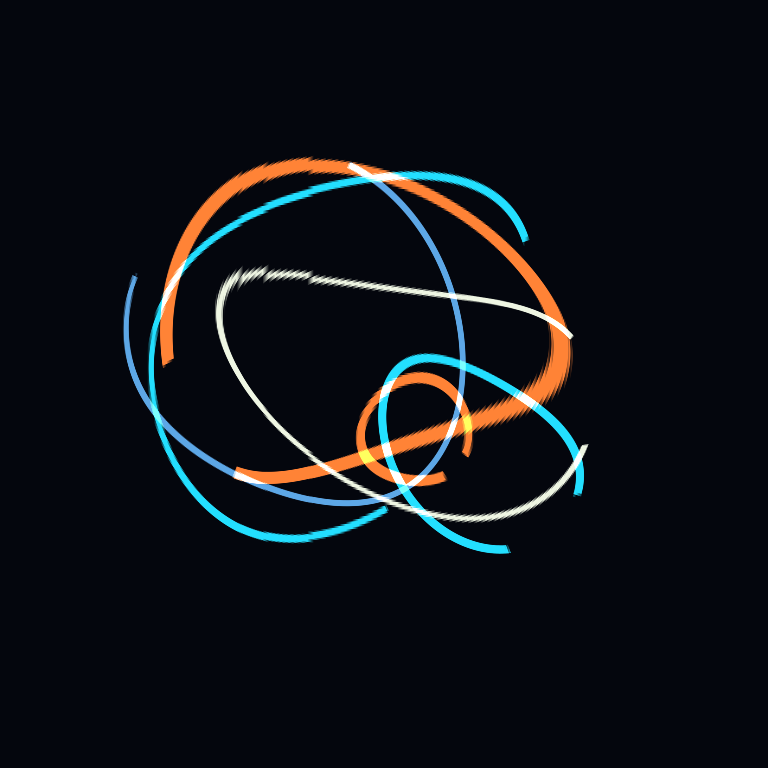
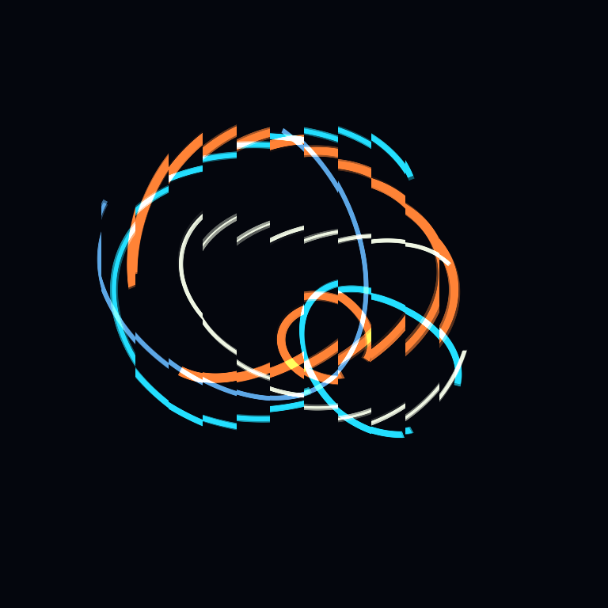
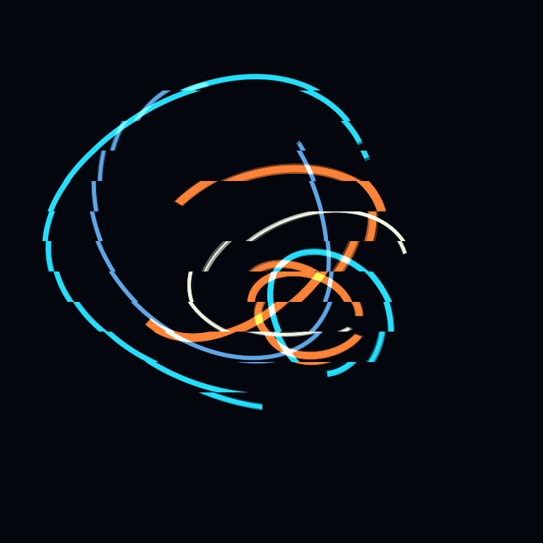
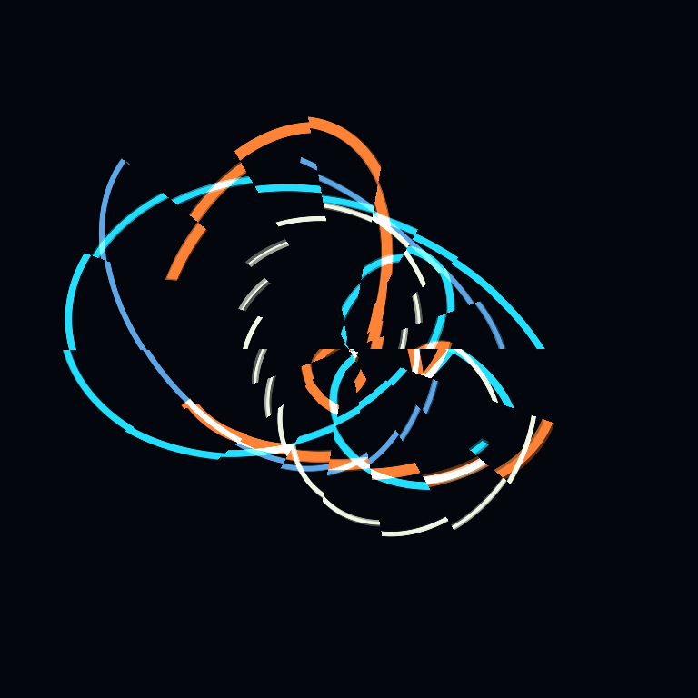
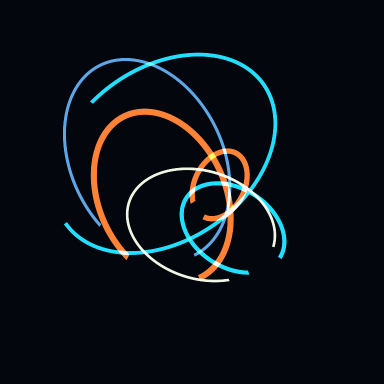
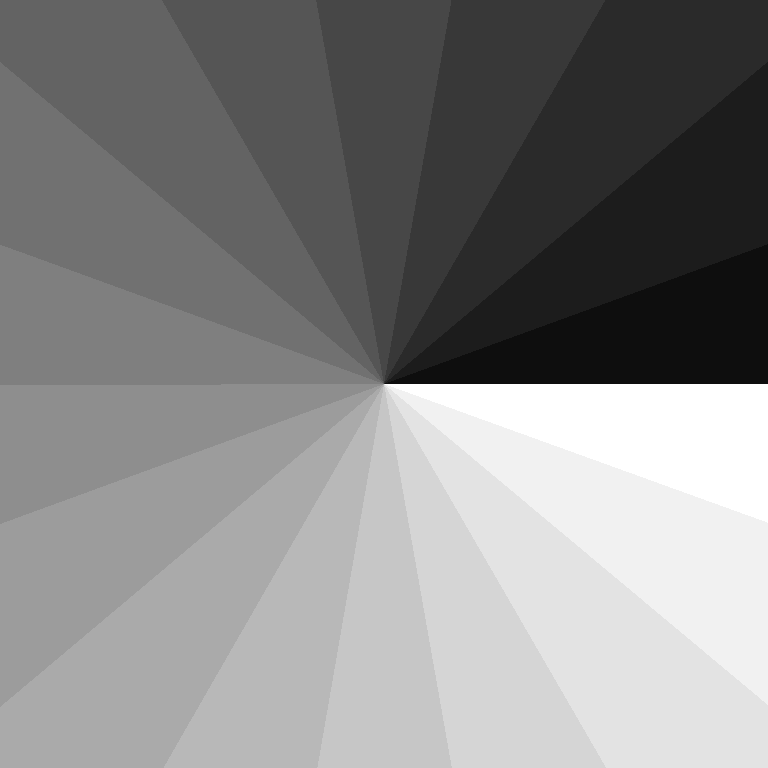
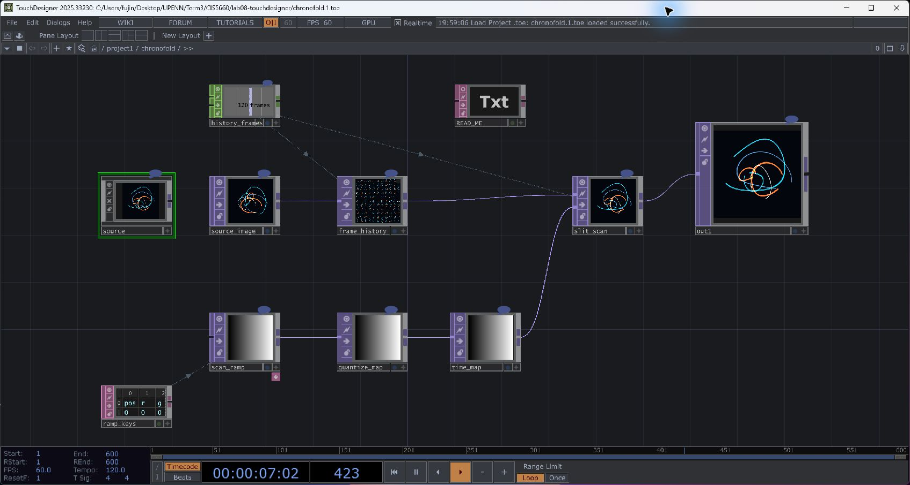

# CHRONOFOLD

**CIS 5660 · Lab 08: TouchDesigner · Jingyu Fu**

A slit-scan study that folds animated cyan, amber, and ivory arcs through time.
Every position in the output can show a different moment of the same animation.



**[Open the TouchDesigner project](chronofold.toe)** ·
[Node network](screenshots/network.jpg) ·
[Rebuild instructions](docs/BUILD.md) ·
[Original assignment](docs/ASSIGNMENT.md)

## Run

1. Open **`chronofold.toe`** in TouchDesigner. It was built and tested with
   **2025.33230** at **768 × 768**.
2. Keep playback running and allow approximately two seconds at 60 FPS for the
   default 120-frame history to fill. Slower cooking takes longer.
3. The file opens inside `/project1/chronofold`. Right-click **`out1`** and choose
   **View** for a larger preview.
4. To adjust the effect, go up one level with **U**, select **`chronofold`**, and
   press **P** to show its parameters. Open the **Slit Scan** custom page.

The input is generated entirely with native TOPs. No webcam, downloaded video,
external media, or Python installation is required to play the `.toe`.

## Scan experiments

These images are actual TouchDesigner outputs. All four variants were exported
from the same frozen history buffer so their time maps can be compared directly.

| Horizontal · smooth | Horizontal · stepped positions |
| --- | --- |
|  |  |
| A continuous time gradient bends and stretches the arcs. | Position quantization cuts the image into vertical time slices. |

| Vertical · stepped positions | Radial · stepped values |
| --- | --- |
|  |  |
| Rotating the scan direction creates horizontal breaks. | Quantizing radial brightness produces concentric bands of different ages. |

<details>
<summary>Inspect the source and a time map</summary>

| Original animated source | Radial time map |
| --- | --- |
|  |  |

</details>

## Node network



```text
source → source_image → frame_history ────────────────────┐
                                                         ├→ slit_scan → out1
ramp_keys → scan_ramp → quantize_map → time_map ──────────┘

history_frames (Constant CHOP) → cache size and time-offset expressions
```

The **source** component combines six animated elliptical arcs using Circle,
Constant, and Composite TOPs. **Texture 3D** records successive frames in a ring
buffer. **Ramp** and **Limit** create the grayscale time map, and **Time Machine**
uses that map to choose an image age independently at every pixel.

For map brightness `m`, the selected offset is:

```text
offset       = (1 - m) × black_offset + m × white_offset
black_offset = -(history_frames - 1) × amount
white_offset = 0
```

Offsets use texture slice indices. Black selects older content, white selects
the current frame, and gray selects an intermediate time. Reversing the offsets
reverses the direction. Setting `amount` to zero makes every pixel current.

## Controls

| Parameter | Default | Effect |
| --- | --- | --- |
| Scan direction | Horizontal | Horizontal, vertical, or radial Ramp TOP |
| Time map style | Smooth | Smooth, stepped positions, or stepped values |
| History frames | 120 | Number of frames in the history texture |
| Time distortion | 1.0 | Fraction of available history sampled |
| Map divisions | 18 | Quantization step size, `1 / divisions` |
| Animation speed | 1.0 | Speed of the original arcs |
| Reverse time direction | Off | Swap the old and current ends of the map |

The history alone uses approximately **270 MiB** at the default settings.
Its time span depends on the actual cooking rate. The smooth mode uses a
floating-point time map, while stepped modes intentionally introduce breaks.

## What I explored

- Replaced the tutorial's camera feed with a self-contained procedural animation.
- Kept the core Texture 3D → Time Machine technique and shared CHOP frame count.
- Compared horizontal, vertical, and radial time maps.
- Compared the tutorial's position quantization with brightness quantization.
- Added controls for history length, distortion amount, motion speed, and reversal.

## Validation

The saved project was reopened and checked again in TouchDesigner:

- No operator errors, script errors, or warnings.
- 768 × 768 output with a 120-slice history texture.
- Zero-distortion output exactly matched the source in the captured check.
- All four presets produced measurable differences from the source.
- Actual output images and the node network were visually inspected.

See the [capture report](screenshots/validation.json) and
[reopen report](docs/reopen_validation.json). The construction and capture
helpers are included in [`scripts/`](scripts/).

## References

- [Clara Nolan's course tutorial](https://youtu.be/fz_PxG5KoNE)
- [Texture 3D TOP](https://derivative.ca/UserGuide/Texture_3D_TOP)
- [Time Machine TOP](https://derivative.ca/UserGuide/Time_Machine_TOP)
- [Ramp TOP](https://derivative.ca/UserGuide/Ramp_TOP)
- [Limit TOP](https://derivative.ca/UserGuide/Limit_TOP)

The tutorial supplies the core temporal-sampling technique; the procedural
source, control page, and scan comparisons are project-specific additions.
