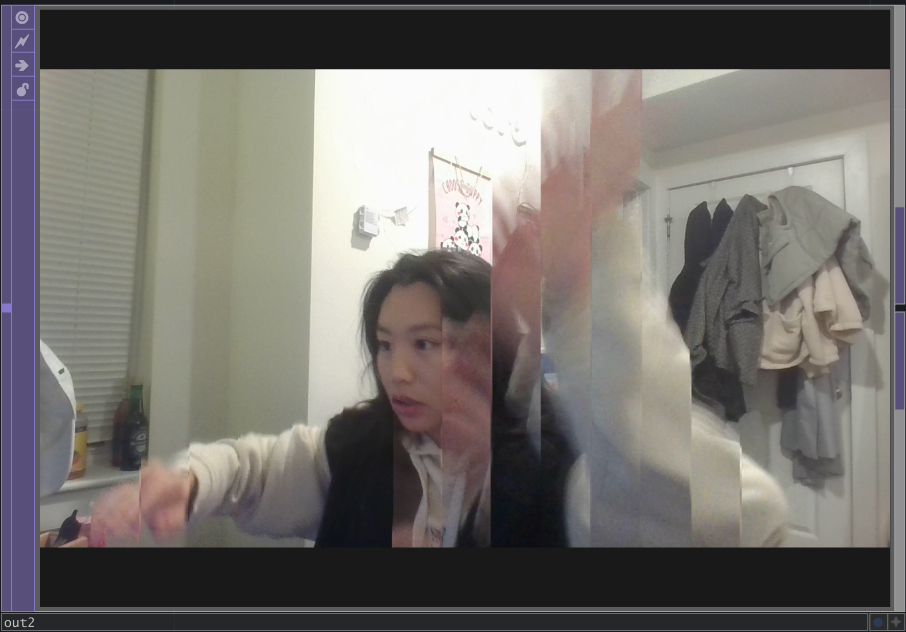
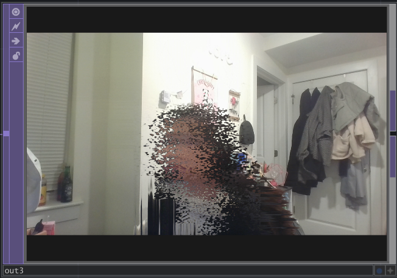

# Lab 08 — TouchDesigner

## Overview

For this lab, I installed TouchDesigner, set up my license, and explored the basic UI and TOP operators.  
The main exercise was creating a **slit-scan effect** using TOPs.

---

## Slit-Scan Effect

Following the class demo (and the [tutorial video](https://youtu.be/fz_PxG5KoNE)), I recreated the slit-scan network and experimented with different parameters such as ramps and noise to modify the visual result.

### Final Output

| Screenshot 1                       | Screenshot 2                       |
| ---------------------------------- | ---------------------------------- |
|  |  |

---

## Files Included

- `lab.toe` — my TouchDesigner project file
- `1.png`, `2.png` — screenshots of the final output
- `README.md` — this file

---

## Notes

I explored how changing the ramp positions and blending methods affected the final slit-scan effect.  
Overall, this lab helped me get comfortable with the TouchDesigner interface and node-based workflows.
